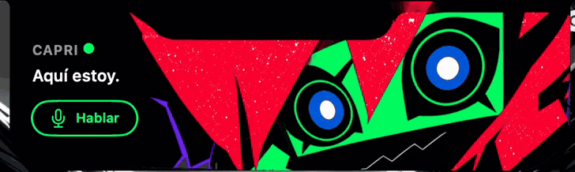
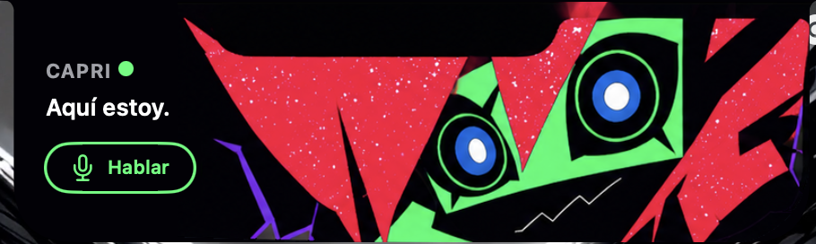
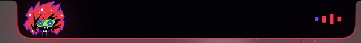
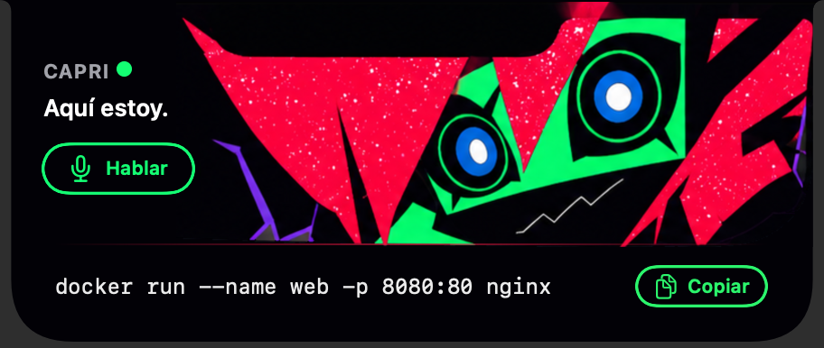
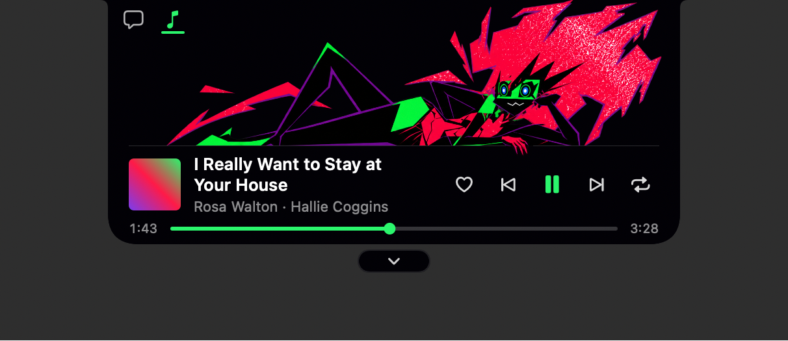
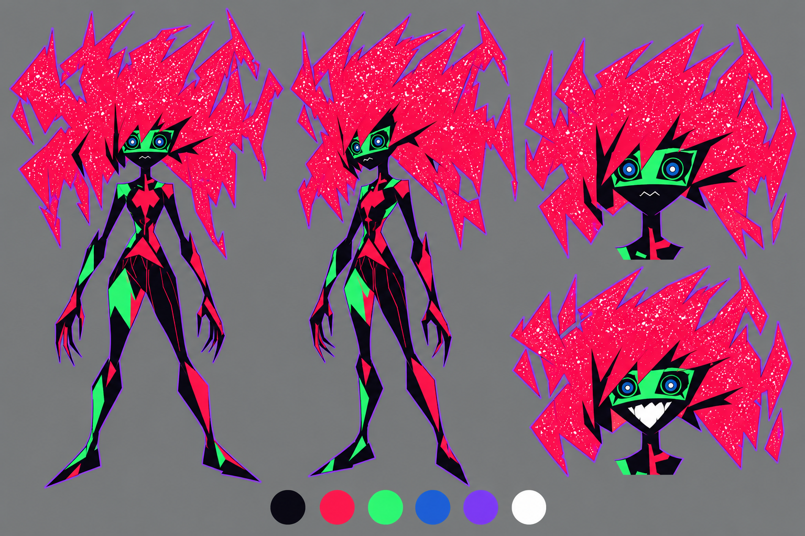
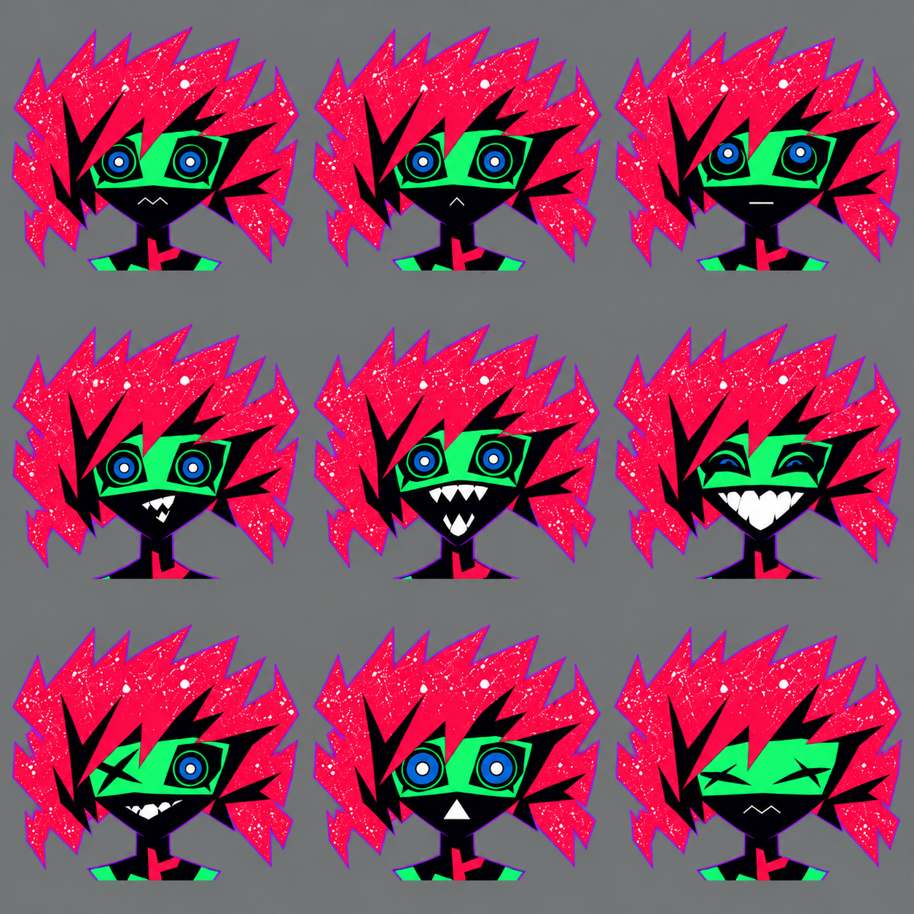
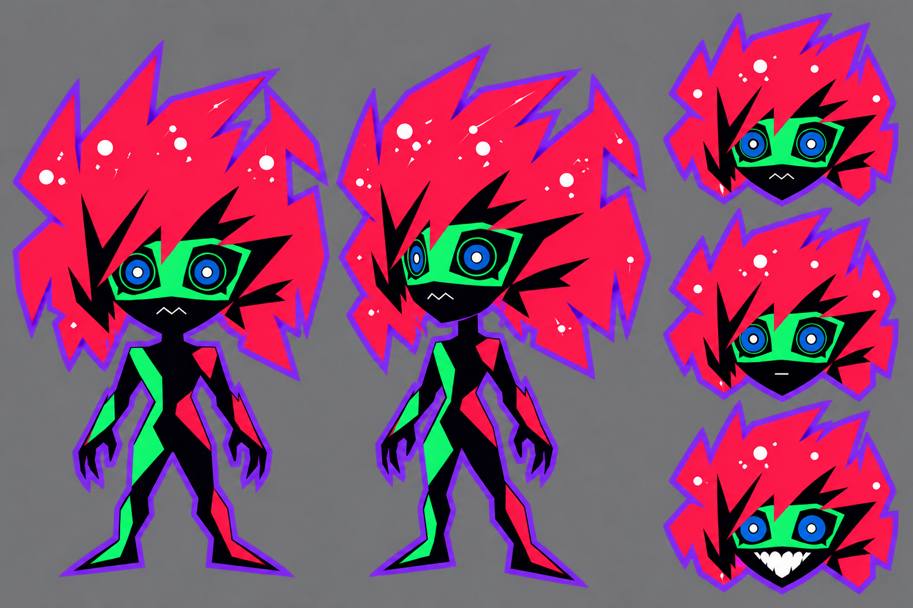

# Capri

Asistente de voz para macOS con la estética de Capri de *Cyberpunk: Edgerunners 2*. Vive en el notch del MacBook y más adelante también aparecerá en el escritorio.

<p align="center">
  
</p>

> 🚧 En desarrollo. Listas: identidad visual, bucle de voz, música en el notch y respuestas con IA. Siguiente: acciones locales (abrir apps, hora, música por voz). Ver el [roadmap](docs/ROADMAP.md).

## Estado actual

Capturas de la app en un MacBook Pro de 14" (notch de 185×32 pt).

### Notch abierto
Al pasar el ratón por el notch, el panel se despliega pegado a la cámara y Capri reproduce su loop: mira a un lado, parpadea y se acerca a la pantalla. Son 16 dibujos completos reproducidos con las duraciones aprobadas (31 cambios en 4 s, de 40 a 640 ms cada uno), no una animación interpolada. El título, el mensaje y el botón son interfaz nativa de macOS.



### Hablar con Capri
Mantén el ⌘ derecho, habla y suelta (o usa el botón Hablar). Mientras escucha, el notch sigue cerrado con Capri chibi a un lado de la cámara y la onda de tu voz al otro. Al responder, el panel se despliega y Capri habla moviendo la boca al ritmo de lo que se oye. Esc la calla, y en pantalla completa se oculta pero sigue atendiendo al atajo.

- **Escucha** en el propio Mac: reconocimiento de voz de macOS en español de México, sin enviar el audio fuera.
- **Piensa** con Claude (Haiku) por la API de Anthropic: respuestas de una o dos frases, directas, para preguntas rápidas como "¿cuál es el comando para ver qué usa el puerto 3000?", "¿cómo reinicio?" o "¿por qué me sale este error?". Recuerda los últimos turnos unos minutos, así que entiende "¿y para verlos todos?".
- **Responde** con una voz local provisional (Qwen3-TTS, generada en el Mac), con Paulina, la voz del sistema, como respaldo. La voz definitiva está en exploración.
- **Habla mientras piensa:** la primera frase suena mientras el modelo escribe el resto y la voz se genera por trozos. De soltar el ⌘ a oírla pasan ~1,5 s.



### Lo que hay que copiar
Capri no lee en voz alta comandos, código ni enlaces. Si la respuesta trae algo así, al terminar de hablar el panel crece hacia abajo con el texto y un botón para copiarlo, y se cierra solo a los 15 s. Las respuestas que solo hay que oír no abren nada.

Si dices "este error" o "lo que copié", el texto del portapapeles acompaña a la pregunta. Si no lo mencionas, no sale del Mac, y lo que los gestores de contraseñas marcan como oculto nunca se envía.



### Música en el notch
Con Spotify sonando, el notch cerrado muestra la carátula a un lado de la cámara y unas barras al otro. Al abrir el panel, la canción, el artista y los controles (anterior, pausa, siguiente) ocupan el sitio de la interfaz de Capri, sin mover su dibujo. La app se entera de cada cambio por los avisos que publica Spotify, sin consultarlo en bucle. Para la carátula y los controles pide permiso de Automatización sobre Spotify la primera vez que hace falta. Sin ese permiso, todo lo demás funciona igual.

| Notch cerrado | Panel abierto |
|---|---|
|  |  |

<sub>Estas dos capturas las genera la propia app (`--snapshot … musica`) con una canción y una carátula de prueba.</sub>

### Rendimiento
Medido con la compilación release y `top`:

| Estado | CPU |
|---|---|
| Notch cerrado, en reposo | 0 % |
| Notch cerrado con música (las barras las anima el servidor de ventanas) | 0 % |
| Panel abierto con Capri animada | ~3 % |
| Escuchando o respondiendo, con el notch cerrado | ~7 % |

La app ocupa unos 70 MB de memoria. La voz local corre en un proceso aparte: se carga la primera vez que le hablas, en lo que tardas en decir la frase, y ocupa ~4 GB mientras la app sigue abierta.

La IA va por API a propósito. Se probó un modelo local (Gemma 4 12B con Ollama): respondía bien, pero ocupaba 10–17 GB junto a la voz y el Mac acababa usando el disco como memoria. Con Claude Haiku la app no ocupa más RAM y cada pregunta cuesta en torno a una décima de centavo de dólar.

## Proceso de diseño

Capri se diseñó por pasos, cada uno aprobado antes de seguir: primero el personaje, luego sus expresiones y una versión simplificada para tamaños pequeños. Después se integró en la app con recortes y tiempos medidos.

| Hoja de personaje | Expresiones | Versión chibi |
|---|---|---|
|  |  |  |
| Diseño base, paleta medida sobre la serie | Nueve caras, una por estado | Se reconoce a 32 px, el alto del notch |

## Qué viene
- Acciones locales: abrir apps y sitios, la hora y pedirle música a Spotify
- Voz definitiva y, más adelante, Capri fuera del notch

Detalle en [docs/CAPACIDADES.md](docs/CAPACIDADES.md).

## Ejecutar

Requiere macOS 14+ y las herramientas de línea de comandos de Xcode. Está pensada para Macs con notch.

```bash
tools/empaquetar.sh --abrir
```

Genera y abre `build/Capri.app`. macOS solo concede micrófono, reconocimiento de voz y accesibilidad (para el ⌘ derecho) a la app empaquetada. Si falta alguno, el punto del panel se pone rojo y el botón pasa a **Permisos**. Para desarrollo rápido de la interfaz, sin esos permisos, también se puede ejecutar el binario: `swift build -c release && .build/release/Capri`.

Pasa el ratón por el notch para abrir el panel.

Para que piense con Claude, guarda una clave de la API de Anthropic en el Llavero (la pide sin mostrarla ni dejarla en el historial):

```bash
security add-generic-password -s com.rosvjames.capri -a anthropic -w
```

Sin clave, Capri usa un modelo local con [Ollama](https://ollama.com) (`gemma4:12b`), que funciona sin internet pero ocupa ~10 GB de RAM. El modelo se cambia con `defaults write com.rosvjames.capri modelo <id>`: los que empiezan por `claude-` van por la API y el resto, por Ollama. También acepta el AI Gateway de Astropods (`tools/clave-astropods.sh`).

Para que "pon tal canción" ponga a sonar el primer resultado (y no solo abra la búsqueda en Spotify), Capri usa la API web de Spotify para buscar. Hace falta una cuenta Premium, porque Spotify la exige al dueño de las apps de desarrollador:

1. En [developer.spotify.com/dashboard](https://developer.spotify.com/dashboard), crea una app. Cualquier nombre y descripción sirven; en *Redirect URIs* pon `http://127.0.0.1:8888/callback` (Capri no la usa, pero el formulario la pide) y marca **Web API**.
2. En los ajustes de la app, copia el *Client ID* y el *Client secret*, y guárdalos en el Llavero desde la carpeta del proyecto, con la app ya empaquetada (cada comando pide el valor sin mostrarlo; `-T` deja que Capri los lea sin preguntar cada vez que se recompila):

```bash
security add-generic-password -U -s com.rosvjames.capri -a spotify-id -T /usr/bin/security -T "$PWD/build/Capri.app" -w
```

```bash
security add-generic-password -U -s com.rosvjames.capri -a spotify-secret -T /usr/bin/security -T "$PWD/build/Capri.app" -w
```

No hace falta iniciar sesión en Capri: solo busca, y la canción la reproduce la app de Spotify. Sin estas claves, o si la API falla, Capri abre la búsqueda en Spotify.

Variables y opciones útiles:

| Variable u opción | Qué hace |
|---|---|
| `CAPRI_ESTADO=reposo\|activo\|abierto` | Fija un estado e ignora el ratón (para medir rendimiento) |
| `CAPRI_DECIR="texto"` | Capri dice ese texto al arrancar, sin micrófono |
| `CAPRI_PREGUNTAR="pregunta\|otra"` | Hace esas preguntas al arrancar, cada 20 s, sin micrófono |
| `--preguntar "pregunta" ["seguimiento"…]` | Imprime las respuestas en la terminal, sin voz ni ventana (las acciones se hacen de verdad) |
| `--entender "frase"…` | Muestra qué orden reconoce Capri sin el modelo, sin hacerla |
| `CAPRI_TTS=paulina` | Usa la voz del sistema |
| `CAPRI_LLM=demo` | Responde sin IA (repite lo que dices) |

La voz local necesita un entorno de Python con [mlx-audio](https://github.com/Blaizzy/mlx-audio) en `~/.venvs/capri-tts` y una referencia de voz que no se incluye en el repositorio. Sin ellos, Capri habla con Paulina (es-MX). Para la mejor calidad, descarga Paulina mejorada en Ajustes del Sistema → Accesibilidad → Contenido leído.

## Stack
Swift, SwiftUI y AppKit con Swift Package Manager. El panel es una ventana transparente sobre la barra de menús, y su geometría se calcula a partir de las medidas reales del notch de cada pantalla. La voz usa Speech y AVAudioEngine; la voz local, un proceso de Python con mlx-audio que entrega el audio por trozos; la IA, la API de mensajes de Anthropic en streaming (HTTP directo, sin SDK) detrás de un protocolo que también admite Ollama; la música, los avisos distribuidos de Spotify y AppleScript.

## Aviso

Fan project no comercial, sin afiliación con CD Projekt Red, Studio Trigger ni Netflix. Capri y *Cyberpunk: Edgerunners* pertenecen a sus respectivos dueños.
